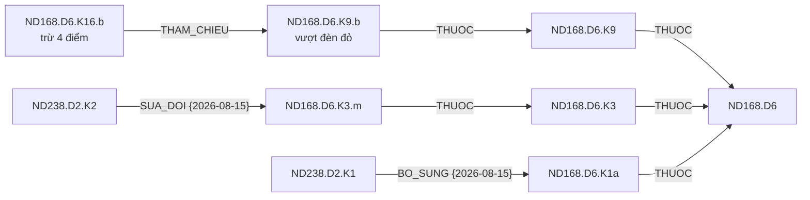

# Thiết kế đồ thị tri thức và phiên bản hiệu lực

TV1 · 21/10/2026 · đã chốt cách A (mỗi phiên bản giữ mã gốc). Áp dụng từ tuần 4.

## 1. Nguyên tắc

1. **Mã đơn vị không đổi theo thời gian.** `ND168_2024.D6.K3.m` luôn là "điểm m khoản 3 Điều 6 NĐ 168",
   dù nội dung đã được NĐ 238 sửa. Câu trả lời trích dẫn, `gold_ids`, node Neo4j đều dùng mã này.
2. **Mỗi lần sửa đổi tạo một phiên bản** của mã đó trong PostgreSQL, khóa `vid = mã@hiệu_lực_từ`
   (`ND168_2024.D6.K3.m@2026-08-15`). Các phiên bản của một mã nối tiếp nhau, không chồng lấn.
3. **Lọc theo ngày là một phép SQL:** `hieu_luc_tu <= ngay AND (hieu_luc_den IS NULL OR ngay < hieu_luc_den)`,
   trả về đúng một phiên bản của mỗi mã (hoặc không có, nếu chưa có hiệu lực / đã bị bãi bỏ).
4. **PostgreSQL giữ nội dung và thời gian, Neo4j giữ quan hệ.** Neo4j có một node cho mỗi mã đơn vị, không có node
   cho phiên bản. Hai kho nối bằng mã đơn vị.
5. Văn bản sửa đổi vẫn là văn bản bình thường trong corpus (tra cứu được), đồng thời là **nguồn** của các cạnh sửa đổi.

Lý do chọn cách A thay vì để nội dung mới nằm ở mã của văn bản sửa đổi (cách B): câu trả lời trích dẫn đúng điều khoản
người dân biết ("điểm m khoản 3 Điều 6 NĐ 168"), lọc theo ngày không cần đi đồ thị, và đối chiếu được với văn bản
hợp nhất (VBHN) để kiểm tra.

## 2. Node (Neo4j)

| Nhãn | Ví dụ mã | Thuộc tính | Nguồn |
|---|---|---|---|
| `VanBan` | `ND168_2024` | id, so_hieu, loai, vai_tro | manifest.csv |
| `Chuong` | `ND168_2024.C2` | id, van_ban_id, so | versions.jsonl |
| `Dieu` | `ND168_2024.D6`, `ND151_2024.D25a` | id, van_ban_id, so | versions.jsonl |
| `Khoan` | `ND168_2024.D6.K3`, `ND168_2024.D6.K1a` | id, van_ban_id, so | versions.jsonl |
| `Diem` | `ND168_2024.D6.K3.m`, `ND168_2024.D41.K4.k1` | id, van_ban_id, so | versions.jsonl |

Đơn vị được chèn bằng văn bản sửa đổi (`K1a`, `D25a`, điểm `k1`) cũng là node bình thường, cạnh THUOC theo mã cha.
Đơn vị đã bị bãi bỏ vẫn giữ node (để hiện lịch sử); nội dung không còn hiệu lực thì PostgreSQL tự loại khi lọc ngày.

## 3. Cạnh (Neo4j)

| Cạnh | Chiều | Thuộc tính | Nguồn | Dùng khi mở rộng |
|---|---|---|---|---|
| `THUOC` | con → cha (Điểm → Khoản → Điều → Chương → Văn bản) | | parent_id | có |
| `THAM_CHIEU` | đơn vị có câu dẫn chiếu → đơn vị được nhắc tới | text | references.jsonl | có, **cả hai chiều** |
| `HUONG_DAN` | Điều của NĐ/TT → Điều/Khoản của Luật được quy định chi tiết | | `data/reference/huong_dan.csv` (lập tay) | có |
| `SUA_DOI` | đơn vị văn bản sửa đổi → mã bị sửa | ngay_hieu_luc, pham_vi | amendments.jsonl | không |
| `THAY_THE` | như trên, khi thay toàn bộ Điều/Khoản | ngay_hieu_luc | amendments.jsonl | không |
| `BO_SUNG` | như trên → mã mới được chèn | ngay_hieu_luc | amendments.jsonl | không |
| `BAI_BO` | như trên → mã bị bãi bỏ | ngay_hieu_luc | amendments.jsonl | không |
| `CHUYEN_TIEP` | điều khoản chuyển tiếp → văn bản bị sửa | | lập tay (ít) | không |

Chiều ngược của `THAM_CHIEU` quan trọng nhất cho câu hỏi về hệ quả: hành vi ở `ND168_2024.D6.K9.b`, còn việc trừ
4 điểm nằm ở `ND168_2024.D6.K16.b` ("Thực hiện hành vi quy định tại … điểm b khoản 9 … bị trừ điểm giấy phép lái xe
04 điểm"), tức là cạnh `D6.K16.b -[THAM_CHIEU]-> D6.K9.b`. Truy xuất được K9.b thì đi ngược cạnh để lấy K16.b.

Cạnh sửa đổi **không** dùng để lấy thêm ngữ cảnh (nội dung mới đã có trong PostgreSQL dưới cùng mã), chỉ dùng để
ghi "đã được NĐ 238/2026 sửa đổi" trong câu trả lời, hiển thị lịch sử (API `/api/units/{id}`) và trang Đồ thị.

`HUONG_DAN` lập tay vì Điều 1 của NĐ 151, TT 38, TT 65 chỉ liệt kê điều khoản Luật được quy định chi tiết, không nói
Điều nào của Nghị định ứng với điều khoản nào. Bảng nhỏ (ước tính 60–80 dòng), làm ở tuần 5.



## 4. Phiên bản: quy tắc

| | Quy tắc | Ví dụ |
|---|---|---|
| R1 | Bản gốc có hiệu lực từ `hieu_luc_tu` của văn bản; ngoại lệ ghi ở cột `ghi_chu` của chính văn bản đó, áp cho mã và mọi mã con | `ND168_2024.D6.K3.m=2026-01-01` |
| R2 | Thao tác sửa đổi có hiệu lực từ `hieu_luc_tu` của văn bản sửa đổi; ngoại lệ ghi ở dòng của **văn bản sửa đổi**, khóa là **mã đích** (hoặc mã cha) | dòng ND238: `ND168_2024.D20.K5.l=2028-01-01`; dòng TT105: `TT65_2024.D6.K1=2027-07-01` |
| R3 | Áp thao tác tại ngày d: đóng phiên bản đang mở (`hieu_luc_den = d`), mở phiên bản mới từ d | |
| R4 | Bãi bỏ: đóng đơn vị và mọi đơn vị con, không tạo phiên bản mới | `ND168_2024.D32.K17.d` từ 15/08/2026 |
| R5 | Nhiều thao tác cùng ngày lên cùng mã: gộp thành một phiên bản, theo thứ tự trong văn bản | |
| R6 | Sửa cụm từ: thay chuỗi trong phiên bản đang mở; không thấy cụm từ thì cảnh báo, không đổi | NĐ 238 Điều 19 |

Ví dụ dòng thời gian của `ND168_2024.D6.K3.m`:

| vid | hieu_luc_tu | hieu_luc_den | loai_phien_ban | nguon_sua_doi | Nội dung |
|---|---|---|---|---|---|
| `…D6.K3.m@2026-01-01` | 2026-01-01 | 2026-08-15 | goc | | Chở trẻ em … cùng hàng ghế với người lái **hoặc không sử dụng thiết bị an toàn** … |
| `…D6.K3.m@2026-08-15` | 2026-08-15 | | sua_doi | `ND238_2026.D2.K2` | Chở trẻ em … cùng hàng ghế với người lái xe (trừ xe ô tô chỉ có một hàng ghế) |

Hỏi ngày 01/10/2025 → không có phiên bản nào (chưa bị phạt). Hỏi 01/09/2026 → phiên bản thứ hai; còn hành vi "không
dùng thiết bị an toàn" chuyển sang khoản mới `ND168_2024.D6.K1a` (phạt cảnh cáo) do NĐ 238 bổ sung cùng ngày.

**Đơn giản hóa đã chấp nhận** (ghi vào phần hạn chế của báo cáo):
- Khi một điểm chỉ lùi hiệu lực **một phần** (NĐ 238 khoản 3 Điều 53 mới: chỉ phần về thiết bị ghi hình với một số loại xe),
  coi như cả điểm lùi hiệu lực.
- Khi câu dẫn của khoản đổi, `ngu_canh` của các điểm con không được tạo phiên bản mới.
- Phụ lục, biểu mẫu không đưa vào corpus.

## 5. Định dạng file

**`data/processed/amendments.jsonl`** (TV2, `graphrag/parsing/amendment_parser.py`): mỗi dòng một thao tác lên một mã.

```json
{"nguon": "ND238_2026.D2.K2", "dich": "ND168_2024.D6.K3.m", "loai": "SUA_DOI", "pham_vi": "toan_bo",
 "noi_dung_moi": "Chở trẻ em dưới 10 tuổi … (trừ xe ô tô chỉ có một hàng ghế);"}
{"nguon": "ND238_2026.D2.K1", "dich": "ND168_2024.D6.K1a", "loai": "BO_SUNG", "vi_tri": {"truoc": "ND168_2024.D6.K1"},
 "noi_dung_moi": "Phạt cảnh cáo đối với người điều khiển xe ô tô thực hiện hành vi chở trẻ em …"}
{"nguon": "ND238_2026.D19.K10", "dich": "ND168_2024.D6.K5.p", "loai": "SUA_DOI", "pham_vi": "cum_tu",
 "cum_tu_cu": "chở người trên nóc xe; để người đu bám ở cửa xe, bên ngoài thành xe khi xe đang chạy",
 "cum_tu_moi": "để người nằm, ngồi, đu bám bên ngoài xe khi xe đang chạy"}
{"nguon": "ND238_2026.D19.K17", "dich": "ND168_2024.D32.K17.d", "loai": "BAI_BO"}
{"nguon": "ND238_2026.D13", "dich": "ND168_2024.D42", "loai": "THAY_THE", "pham_vi": "toan_bo",
 "noi_dung_moi": "Điều 42. Thẩm quyền xử phạt của Chủ tịch Ủy ban nhân dân các cấp", "tieu_de": "Thẩm quyền xử phạt …"}
```

- `noi_dung_moi` là chữ của **riêng** đơn vị đó, không có dấu ngoặc kép, không gồm điểm con. Khối trích dẫn nhiều cấp
  ("Sửa đổi khoản 5 như sau: “5. … a) … b) …”") được tách bằng `structure_parser` thành nhiều thao tác: khoản 5
  (câu dẫn), từng điểm, và `BAI_BO` cho điểm cũ không còn trong khối mới.
- Thay toàn bộ Điều (NĐ 238 Điều 13–15, TT 105 Điều 1–2): một `THAY_THE` cho Điều + thao tác cho từng khoản/điểm mới
  + `BAI_BO` cho khoản/điểm cũ không còn.
- "Thay cụm từ … tại điểm a khoản 2, điểm g khoản 5 Điều 6" → một thao tác `cum_tu` cho mỗi mã đích.
- `ngay_hieu_luc` để trống; bước 2 tự tính theo R2 và ghi lại vào file.

Số câu lệnh sửa đổi ước tính (đếm theo động từ mở đầu trong corpus): NĐ 238 khoảng 50, Luật 118 khoảng 40,
NĐ 236 khoảng 30, NĐ 184 khoảng 10, TT 105 và TT 13 vài câu nhưng thay toàn bộ Điều 6, 7 TT 65.

**`data/processed/references.jsonl`** (TV2, `reference_extractor.py`):
`{"src": "ND168_2024.D6.K16.b", "dst": "ND168_2024.D6.K9.b", "loai": "THAM_CHIEU", "text": "điểm b khoản 9 Điều này"}`.
Dẫn chiếu tới văn bản ngoài kho (Luật Xử lý vi phạm hành chính, NĐ 100/2019…) ghi `"dst": null, "ngoai_pham_vi": true`.
Dẫn chiếu bên trong khối trích dẫn của văn bản sửa đổi tính theo văn bản bị sửa ("Điều này" = Điều của NĐ 168).

**`data/processed/versions.jsonl`** (tự sinh ở bước 2 bởi `graphrag/parsing/versioning.py`): mỗi dòng một phiên bản,
đúng các cột của bảng `don_vi` trừ `embedding`. Bước 3 tính embedding cho mọi phiên bản, bước 4 nạp thẳng file này.
Khi `amendment_parser` chưa xong, file chỉ chứa bản gốc (đã áp ngày hiệu lực và ngoại lệ trong manifest).

## 6. Luồng dữ liệu

```
corpus.jsonl ──► amendment_parser ──► amendments.jsonl ─┐
     │                                                   ├─► versioning.build_versions ──► versions.jsonl ──► 03_embed ──► 04_load
     └──────────► reference_extractor ──► references.jsonl ┘        (R1–R6, manifest)                              │
                                                                                           PostgreSQL don_vi ◄─┤
                                                                                           Neo4j node + cạnh ◄─┘
```

Thay đổi so với thiết kế cũ: `don_vi` khóa `vid` (thêm `nguon_sua_doi`, `loai_phien_ban`, `thu_tu` kiểu REAL);
tìm kiếm trả về `vid`, pipeline đổi sang mã bằng `graphrag.common.ids.base_id`; `fetch_valid` nhận mã đơn vị;
`neo4j_store.expand` không còn đi theo cạnh sửa đổi, thêm `amended_by`.

## 7. Truy vấn trong pipeline GraphRAG

1. Seed: BM25 + vector → RRF → rerank → danh sách `vid` → `base_id`, bỏ trùng.
2. `neo4j_store.expand(seed_ids, hops=1, edge_types=cfg.graph.edge_types)` → thêm tối đa `graph.max_expand` mã.
3. `postgres.fetch_valid(mã, ngay)` → phiên bản đúng ngày; mã không có phiên bản hợp lệ bị loại khỏi ngữ cảnh.
4. `neo4j_store.amended_by(mã trong ngữ cảnh)` → ghi chú "được NĐ … sửa đổi, hiệu lực từ …" trong ngữ cảnh gửi LLM.

Ablation (môn NLP): tắt bước 2 (`use_references`), tắt bước 3 (`use_temporal_filter`: lấy phiên bản mới nhất),
tắt phiên bản (`use_amendments`: chỉ dùng bản gốc), `hops` = 1 hoặc 2.

## 8. Việc tiếp theo

| Việc | Người | Tuần |
|---|---|---|
| ~~`amendment_parser`~~ đã xong (397 thao tác, 21/10); kiểm tra tay 30 thao tác ngẫu nhiên, nhập tay NĐ 238 khoản 2 Điều 17 | TV2 | 4 |
| ~~`reference_extractor`~~ đã xong (1.733 dẫn chiếu); kiểm tra tay 50 dẫn chiếu ngẫu nhiên | TV2 | 4 |
| ~~`04_load.py`, `load_structure`, `load_relations`~~ đã xong; chạy trên máy và trên cloud | TV2 | 4 |
| `data/reference/huong_dan.csv` | TV1 + TV2 | 5 |
| So khớp phiên bản Luật 36 hiện hành với VBHN 55 (kiểm tra `amendment_parser`) | TV1 | 5 |
| `graph_rag.answer` theo mục 7 | TV1 | 5–6 |
